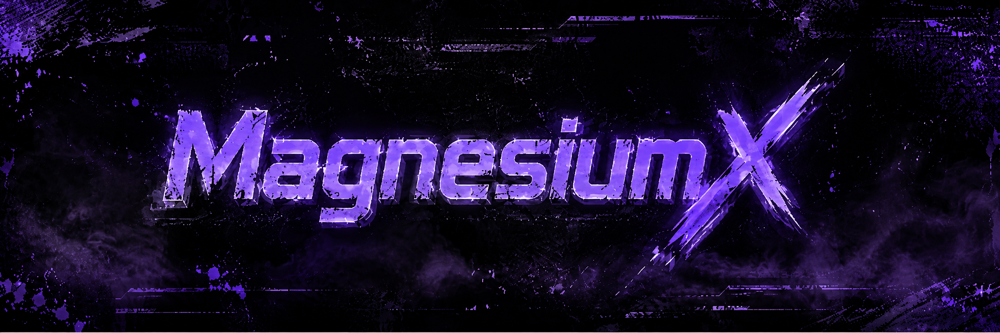

<p align="center">
  
</p>

# MagnesiumX-Deadline

> Born from the ancient forbidden soup known as **Potash**, we present:  
> **MagnesiumX** - a Roblox GUI/script project with style, chaos, and questionable levels of purple.

bro who made this readme, its aids

Is it useful?  
Hopefully.

Is it purple?  
Very.

---

## What is MagnesiumX?

MagnesiumX is our GUI/script hub thingy™ designed around:

- A clean dark UI
- Purple accent colors because purple is simply superior
- Player-related actions
- Main utility features
- ESP-related tools
- Configurable controls like buttons, toggles, sliders, inputs, and color pickers
- A vibe best described as: `edgy terminal catboy dashboard`

Basically:

```lua
print("mrrp nyaa :3")
```

---
## Character Scheme: 
workspace.characters[charname]


oki thats all for now uwu

--- vixiie was here <3